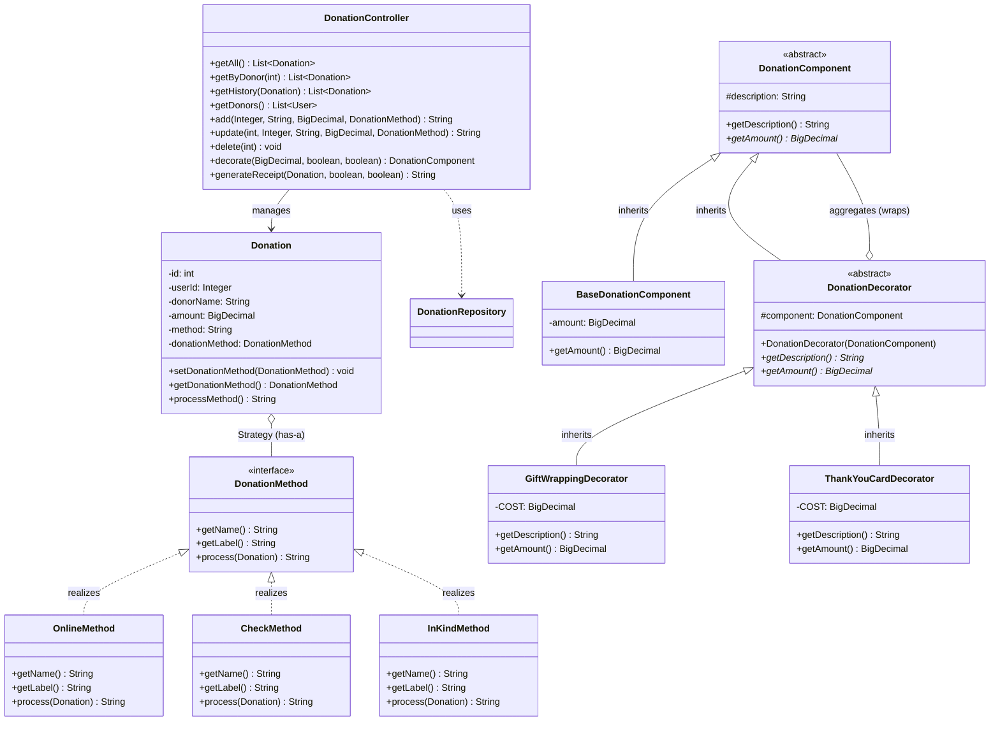

# Sanad - Non-Profit Management System

CSE336 Software Design Patterns, Phase 1. Team T08 "Sanad".

One desktop app for a non-profit's donations, volunteers, events, beneficiaries and communication.
Built with Java 17, JavaFX 21 and MySQL 9.7.

## Run it

You need JDK 17+ and Docker Desktop (running). Maven comes with the repo through the wrapper.

```bash
./mvnw javafx:run
```

On Windows use `.\mvnw.cmd javafx:run` in PowerShell, or `mvnw javafx:run` in CMD.

That one command compiles the code, starts MySQL in Docker and opens the app.
The first run downloads the MySQL image, so it takes longer.
On start the app runs the Flyway migrations in `src/main/resources/db/migration`, which create the tables and starting
lookups.

| To            | Run                      |
|---------------|--------------------------|
| Stop MySQL    | `docker compose down`    |
| Wipe all data | `docker compose down -v` |

The app opens on a login screen. On a new database, sign in as `admin` with password `admin123`, then change that
password in the Users tab. Each user type only sees its own sidebar sections.

MySQL keeps running after you close the app. Data lives in the Docker volume `mysql-data`, so it survives restarts.

**Without Docker:** install MySQL 9.7, create a database called `sanad`, put your URL, user and password in
`src/main/resources/db.properties`, then run `./mvnw javafx:run -Dexec.skip`.

## Code layout (MVC)

```
com.sanad
├── App.java        starts the program
├── auth/           Session (Singleton) + PasswordHasher
├── db/             DatabaseConnection (Singleton)
├── model/          data classes + repositories (SQL), one package per module
├── controller/     one per module: validates input, calls the repository
└── view/           JavaFX tabs, one per module
```

Every feature follows the same path:

```
View (button click) -> Controller (validate) -> Repository (SQL) -> MySQL
```

Views never talk to the database directly.

**Adding a module:** copy the four Volunteer files (`Volunteer`, `VolunteerRepository`, `VolunteerController`,
`VolunteerView`) and rename them. Then add its table in a new migration such as
`src/main/resources/db/migration/V3__create_grants.sql` and its tab in `view/MainView.java`. Never edit a migration that
has already run.

## Team rules

- Write each pattern the way the lecture does: same class shapes and method names.
- No `System.out` in model, controller or pattern classes. Only views show output.
- Class diagram: no empty or stand-alone classes, no "System" god class. Use interfaces where possible and
  mix association, aggregation, inheritance and realization.
- No Phase 2 patterns yet (Command, Adapter, Facade, Template Method, Iterator, State, Proxy).

## Phase 1 work

Phase 1 tasks are tracked in the repo's [GitHub issues](https://github.com/gadarars/SDP-sanad/issues).

### Donation Module Patterns & Class Diagram

#### 1. Strategy Pattern (Interchangeable Donation Methods)
- **Strategy Interface:** `DonationMethod` (`getName()`, `getLabel()`, `process(Donation)`)
- **Concrete Strategies:** `OnlineMethod`, `CheckMethod`, `InKindMethod`
- **Context:** `Donation` holds a `DonationMethod`, delegates `processMethod()` to it, and supports runtime switching via `setDonationMethod(DonationMethod)`.
- **Registry:** `DonationMethods` provides lookup by name and retrieves all strategies for UI selection.

#### 2. Decorator Pattern (Optional Donation Add-ons)
- **Abstract Component:** `DonationComponent` (`getDescription()`, `getAmount()`)
- **Concrete Component:** `BaseDonationComponent`
- **Abstract Decorator:** `DonationDecorator` (extends `DonationComponent`, aggregates wrapped `DonationComponent`)
- **Concrete Decorators:** `GiftWrappingDecorator` (+EGP 25.00), `ThankYouCardDecorator` (+EGP 15.00). Decorators can be arbitrarily stacked.



## Submission checklist

1. SRS (Word or PDF) with every member's name.
2. Code zip, without `target/`.
3. Text file with the GitHub repo link.
4. Grading criteria sheet with names and IDs filled in.

Check the LMS for the exact requirements.
